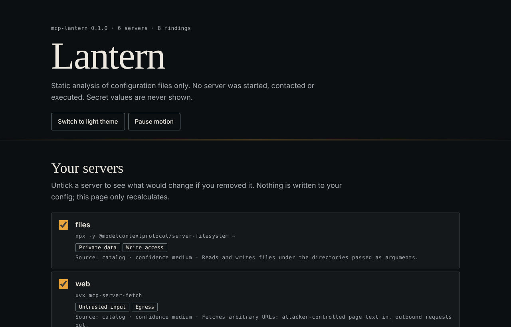
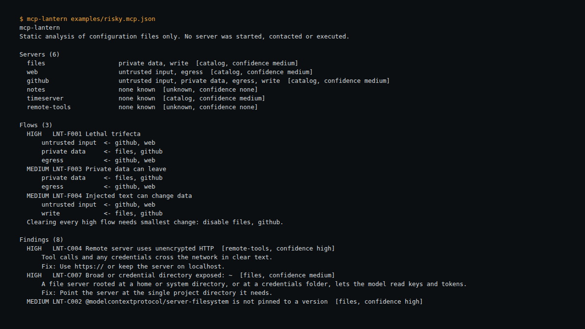

# mcp-lantern

An offline auditor for MCP client configuration. Point it at your `mcp.json`, `claude_desktop_config.json` or `.vscode/mcp.json` and it answers one question: **which combinations of the servers I have configured could let injected text lead to my data leaving, and what is the smallest change that stops it?**

It reads files only. It never starts, contacts or executes a server, makes no network requests, has no dependencies (Python 3.9+ standard library), and never prints secret values.



## Why this exists

Most advice on MCP safety is a manual checklist, and pattern scanners are noisy: one 2026 audit of 33 servers found roughly 78% of a pattern scanner's detections were false positives. The real risk is usually a *combination*: a server that reads text other people write, plus one that reads your private data, plus one that can send data out. Lantern models that combination and lets you try removals before you edit anything. See [docs/RESEARCH.md](docs/RESEARCH.md) for sources and for prior art (Invariant/Snyk's toxic flow analysis is the same family of idea; Lantern does not claim to have invented it).

What it adds: fully offline and deterministic, every finding explained with a fix, an interactive what-if report, a user-extensible catalog, and SARIF output for CI.

## Use

```bash
pip install .                         # or: PYTHONPATH=src python -m mcp_lantern ...
mcp-lantern path/to/mcp.json          # text report
mcp-lantern --discover                # also read well-known client config locations that exist
mcp-lantern mcp.json --format html -o lantern-report.html
mcp-lantern mcp.json --format sarif -o lantern.sarif --fail-on high   # CI gate
mcp-lantern mcp.json --annotate examples/annotations.json             # declare your own servers
mcp-lantern mcp.json --baseline last-month.json --fail-on medium     # gate only on risk added since an earlier config
```

`--baseline FILE` (repeatable) compares the config against an earlier one and reports servers added, removed or changed, flows introduced or cleared, and findings introduced or resolved. With `--fail-on`, only newly introduced flows and findings count, so existing known risk does not fail the build. Text and JSON output only. Servers are matched by name; a server renamed between the two files appears as one removal and one addition.

Exit codes: `0` clean or below the `--fail-on` threshold, `1` threshold met (or a file could not be read), `2` usage error or nothing could be parsed.

Try it: `mcp-lantern examples/risky.mcp.json --format html -o report.html` and untick servers in the page.

## What it checks

Flow rules (combinations of capabilities across servers) and config checks are listed in [docs/RULES.md](docs/RULES.md). Capabilities are `untrusted_input`, `private_data`, `egress`, `exec`, `write`.

## Limits you should know

- **Capabilities are inferred, not observed.** They come from a small catalog keyed on package names and URLs (`src/mcp_lantern/catalog.json`), written from general knowledge of well-known servers and not checked against their real tool lists. Each server shows its basis (`annotation`, `catalog`, `keyword`, `unknown`) and a confidence label.
- **Unknown does not mean safe.** Unknown servers contribute no capabilities until you declare them with `--annotate`.
- **Token scope is invisible.** A GitHub server's real reach depends on the token's permissions, which a config file does not show.
- **A flagged flow is a possibility, not an attack.** It needs an attacker to place instructions where the model reads them.
- **Config only.** No runtime monitoring, no tool-description analysis, no server code review. Use alongside those, not instead.
- OAuth cannot be seen in a config; the "no credential header" finding is therefore low confidence.
- Client formats beyond `mcpServers` and VS Code's `servers` are handled by searching nested objects; VS Code and remote-server field names were not confirmed from official documentation (see RESEARCH.md).

## Roadmap

Not done yet, in rough order of value:

- Optional live mode: connect to a running server and read its real tool list, instead of relying only on the static catalog.
- Expand `catalog.json` with more servers, each confirmed against the server's own documentation rather than general knowledge.
- Confirm the VS Code and remote-server config field names against official documentation (currently inferred; see RESEARCH.md).

## Development

```bash
python -m unittest discover -s tests        # 32 tests
python tests/parity_browser.py              # optional; needs playwright: compares the report's JS to Python
```

Design, motion, accessibility and technique notes: [docs/DESIGN.md](docs/DESIGN.md). A three-minute demo script: [docs/WALKTHROUGH.md](docs/WALKTHROUGH.md).

## Provenance

Tests were written alongside the code. Not yet independently reviewed; the tests and documented limits describe what has been checked. Licence: MIT.

Designed and built by Maak — https://github.com/0xM44k

## Evidence



The image above is a capture of the command shown at the top of the image, run against the files in this repository on 2026-10-28. It is the tool's actual output, rendered in a terminal panel for legibility; no output lines were invented.
